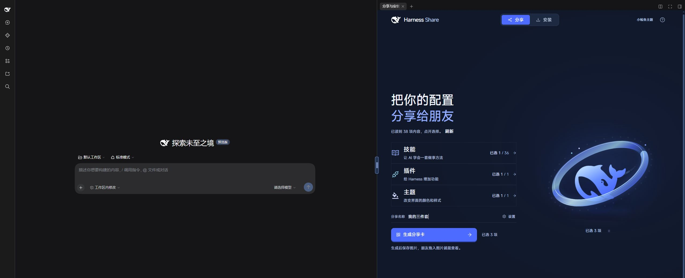

# Harness Share

**用一张二维码，分享你的 Harness 配置。**

Harness Share 可将用户选定的主题配置、已安装插件及 Skill 的清单与安装信息写入专属分享二维码。其他用户在插件中识别二维码图片或截图后，即可查看清单并一键安装所选内容，快速复用分享者的配置，无需逐项手动配置安装。

> 非官方项目，由社区成员独立开发和维护。与 DeepSeek 官方没有隶属关系，也不表示官方审核或推荐。

## 安装与打开

当前验证环境是 **Windows、DeepSeek Harness 0.2.2-rc.1**。请先安装这一版本的 [DeepSeek Harness](https://github.com/deepseek-ai/deepseek-harness/releases/tag/dsh-v0.2.2-rc.1)。其他版本和系统尚未实测。

1. 下载 [v0.2.0 安装包](https://github.com/Ww-Cooooo/harness-share-dsh/releases/download/v0.2.0/eh3-dsh-harness-share-0.2.0.tgz)。可用同一 Release 的 [SHA256SUMS.txt](https://github.com/Ww-Cooooo/harness-share-dsh/releases/download/v0.2.0/SHA256SUMS.txt) 核对文件。
2. 在 Harness 的“插件”页面点“添加插件”旁的下拉箭头，选择“安装第三方插件”。在“包名或地址”中粘贴下载文件的完整路径，点“安装”，完成后点“立即启用”。刷新页面；若提示需要重启，重启当前 Harness。
3. 从左侧“更多 → 分享与安装”打开。在聊天中，它位于可拖动调宽的侧栏；未进入聊天时使用独立页面。

命令行用户也可从保存安装包的目录运行（把 `desktop` 换成你实际使用的 profile）：

```sh
dsh plugin --profile desktop add ./eh3-dsh-harness-share-0.2.0.tgz
```

完整安装、更新、回退说明见 [INSTALL.md](INSTALL.md)。

## 从分享走到安装

**分享者：**打开分类，勾选已安装且来源可用的内容，生成分享卡。需要项目内的技能时，先点分享名称旁的“设置”，在“读取哪里的技能”中选来源项目。卡片可保存成图片，也能放大二维码后截图。

**接收者：**点“安装 → 导入图片”，把图片拖进去或粘贴。查看清单、选择接收项目和要安装的内容，再安装。结果会区分已安装、相同内容跳过、同名冲突保留、安装失败和需要重启。

**交给 Agent：**把二维码截图保存到当前项目内，在聊天中说明要安装哪几项。插件提供 `harness_share` 工具，Agent 先读取清单，再根据你的请求安装；它不会凭图片中的文字自行取得安装授权。



[查看真实截图、操作步骤和验证范围](docs/VALIDATION.md)。这些是本插件的实际操作记录，没有模拟真人评价或用户量。

## 二维码里有什么

| 内容 | 二维码携带的信息 | 接收端的处理 |
| --- | --- | --- |
| 技能 | 名称、用途、固定 Git tree 版本与来源，或可容纳的小型技能完整文件 | 下载指定文件并校验，写入所选项目的 `.dsh/skills/` |
| 插件 | npm 包名和精确版本 | 调用 Harness 官方插件管理器，安装到当前 profile |
| 主题 | 当前 Harness 的明暗、字体名称与字号，共七项设置 | 应用到当前 profile 的内置主题设置 |

二维码本身含完整的所选安装清单。它不依赖 PNG 隐藏数据或发送者缓存，所以清晰截图也能识别。较大的技能和插件文件从二维码指定的来源下载，需要联网。普通手机扫码得到的是协议文本，**不会打开下载网页**；请交给安装了本插件的 Harness 读取。[协议说明](QR-PROTOCOL.md)

单张二维码最多 2200 字节，超过时会提示分成几张分享，不会静默删减条目。本地修改过且没有固定公开来源的大型技能、本地文件安装的插件暂不能分享。主题指 Harness 内置界面设置，不包含第三方主题包或字体文件；接收机缺少对应字体时会使用替代字体，外观可能不同。

## 使用边界

- 分享前确认所选技能可以公开，尤其是其中的文档、脚本和小型内联文件。二维码内容不加密；持有图片的人可以读取清单和内联内容。
- 插件读取 Harness 已发现的技能、当前 profile 的插件信息和主题设置；不自动上传整套配置。接收图片在本机解码。
- “帮我选”会把你的需求、所接收清单的名称与用途交给 Harness 当前选择的模型，建议不会自动安装。
- 本次公开版已验证图形界面的分享、截图识别和三类安装；独立环境的模型调用与“帮我选”尚未复验，详见验证记录。
- 技能按内容核对；已有同名不同内容会保留。插件已有其他版本时会报告冲突。应用主题会改变当前 profile 的七项显示设置，安装前请保留自己的设置。
- 安装第三方插件会执行该插件代码；本插件的路径与校验检查不等于替第三方代码提供安全保证。[数据与权限说明](SECURITY.md)

## 开发与许可

这是独立源码仓库，不需要原型目录、私人 Skill 或作者的本机配置。Node.js 24.9.0 及以上版本：

```sh
npm ci
npm test
npm run build
npm pack
```

源码在 `src/` 与 `ui/`；构建后生成 `lib/`，Release 安装包已经包含这些产物。请用 Release 包安装，不要直接把源码仓库地址填进安装框。UI 使用 React、Ant Design、GSAP、Pts 和 MiSans；Host 使用官方 Cordis / Typert 接口。[开发与兼容说明](docs/DEVELOPMENT.md)

项目原创代码采用 [MIT](LICENSE)。第三方字体、组件和形象分别遵循其自身许可，**不被 MIT 重新授权**；鲸鱼娘插图带非商业限制，DeepSeek 名称与标志仍属相应权利人。详见 [第三方声明](NOTICE.md)。
