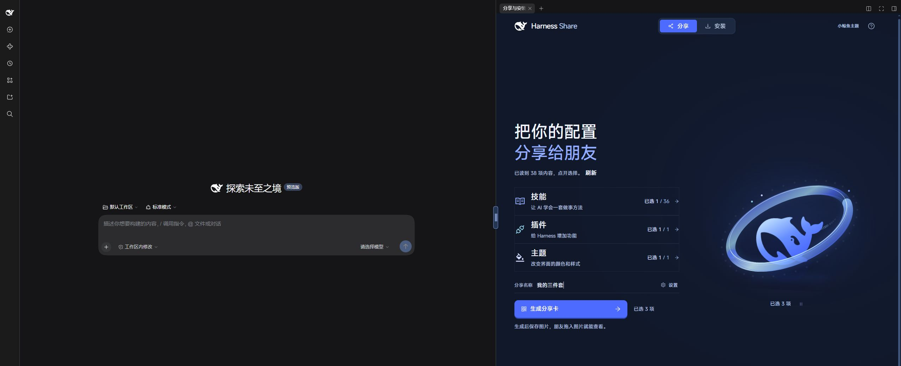
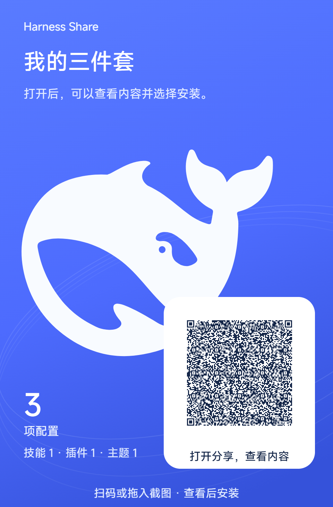
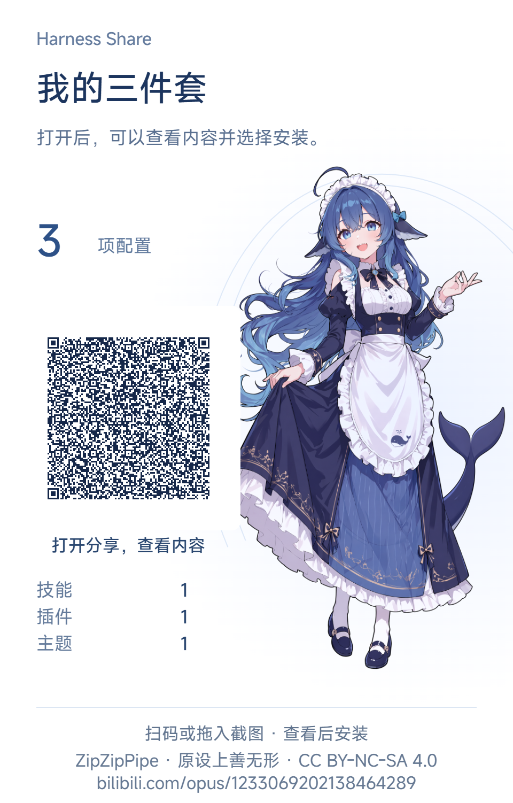
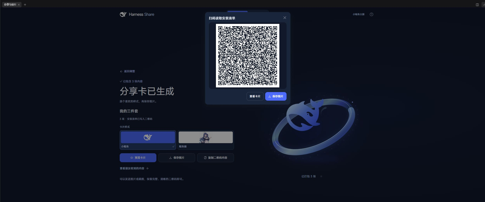
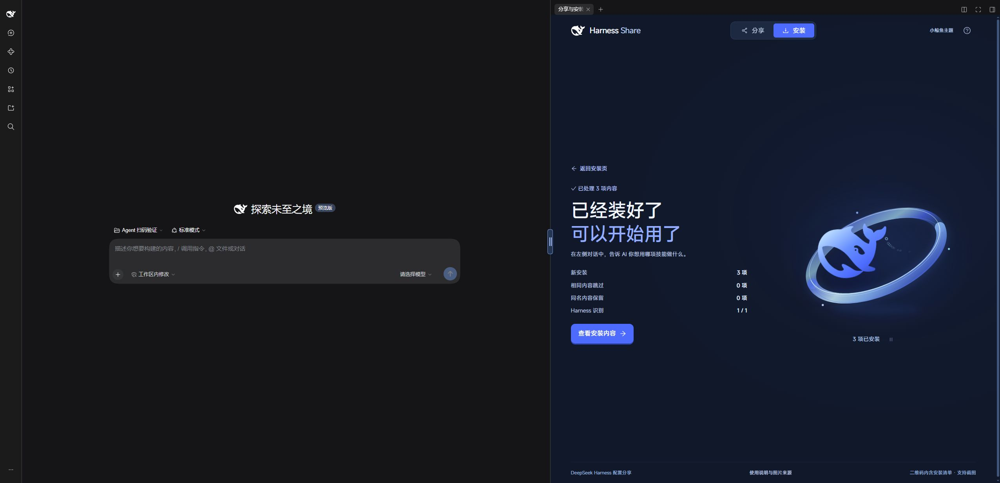
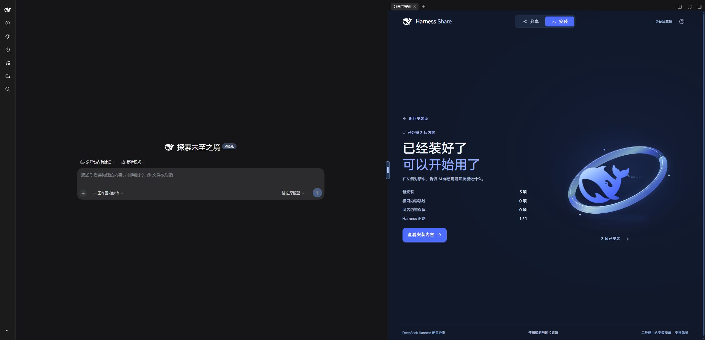

# 真实演示与验证范围

本页记录 Harness Share 0.2.0 在 Windows、DeepSeek Harness 0.2.2-rc.1 上的实际操作。演示由开发代理操作本机界面完成，没有真人试用统计、模拟用户评价或其他项目的测试数字。

## 一次分享，三类内容

2026-11-11，分享端从实际已安装内容中选择 `find-skills`、`dsh-whale-widget 0.4.2` 和当前界面主题，生成“我的三件套”。接收端使用独立 profile 和空的接收项目；安装前页面显示“可新装 3 项 · 已有 0 项”。

1. 从左侧“更多 → 分享与安装”进入聊天旁的侧栏。拖动中间手柄，宽时左右布局，窄时上下布局。以下截图保留真实界面，部分裁掉无关区域。

[窄栏截图](demo/narrow.jpg)

2. 选择三类内容，生成分享卡。两种卡片与放大二维码的 JPG 截图均能从像素解码，得到同一份 **674 字节**的 v3 清单。没有读取 PNG 附加数据。

| 小鲸鱼 | 鲸鱼娘 |
| --- | --- |
|  |  |

可对照 [从截图解出的清单](demo/qr-manifest.json)。这是可实际读取的示例；安装仍需接收者主动选择。

3. 在另一 profile 点“安装 → 导入图片”，粘贴上述 JPG 截图，识别三项内容。选择接收项目后实际安装，结果如下：

| 对象 | 实际结果 |
| --- | --- |
| `find-skills` | 从 `vercel-labs/skills` 的固定 Git tree `76a98a285cb0434f3d39e1a873823556330e398b` 下载；同时保留来源许可证。项目中的 `SKILL.md` SHA-256 与分享端一致：`c00eeea0e13e74fe4a9d84ba0a8542205a1b736d65f13134fe1a6647eb14976f`。Harness 目录发现和项目文件读取均成功。 |
| `dsh-whale-widget` | 官方插件管理器安装精确版本 `0.4.2`，Host 返回已应用，未要求重启；安装后的包版本回读一致。该插件自身的余额查询功能需要另行配置账号，本次不以余额数据证明安装成功。 |
| 当前界面主题 | 明暗、三种字号、三种字体名称共七项写入接收 profile，并回读一致。演示值详见二维码清单。 |

综合安装回执：`34edfbff-d996-4d53-b128-5b308451c052`，新安装 3 项、冲突 0 项、失败 0 项。技能目录发现与项目文件读取通过，插件 Host 已应用，主题回读一致；这些结果不代表模型已调用它们。完整本地回执含机器路径，未公开上传。

## 检查与边界

- 源码自动测试：12 项通过，覆盖二维码内容、容量、PNG/JPEG 像素读取、固定来源与文件校验、选择安装、重复与冲突、危险路径、符号链接和安装锁。
- 独立源码构建和预构建包安装已执行。全新参数为空时的启用问题已修复；测试环境移出旧项目包目录，避免模块自引用解析到旧代码，并核对当前页面不再含未获许可的 Q 版资源。
- 上述安装由图形界面实际触发。`harness_share` Agent 工具已实现并随 Host 注册；本次独立环境尚未登录模型，因此**未将本次结果称为模型调用验证，也未验证“帮我选”**。模型连接和使用仍由用户配置。
- 测试只覆盖本页列出的技能、插件和内置主题设置，不表示所有第三方内容都已验证。清晰、完整的二维码可识别；模糊、裁切或过小的缩略图不保证成功。
- 兼容性只声明本次宿主版本与 Windows；其他系统和后续版本尚未实测。

## 发布后的匿名下载复验

2026-11-11 19:40（中国时间），从公开 [Release v0.2.0](https://github.com/Ww-Cooooo/harness-share-dsh/releases/tag/v0.2.0) 下载安装包和校验文件。下载使用不带账号授权头、Cookie 的 HTTPS 请求；网络较慢时续传，最后对完整文件核验。

- 包名：`eh3-dsh-harness-share-0.2.0.tgz`，15,410,712 字节。
- SHA-256：`88c30c4b1b5817627ea98282214b6bd75650dd4dcb55180540f81c017fd55899`，与 Release 校验文件和本地发布包一致。
- 通过官方 `dsh plugin --profile … add <下载文件>` 安装到新建的专属 profile；只启用宿主内置 Web 入口和本插件。插件管理页回读 `v0.2.0`、已启用、一个组件运行中。安装后的 Host 与页面产物 hash 均与发布构建一致。
- 进入真实聊天侧栏，粘贴同一张 JPG 截图，选择另一个空接收项目。安装前为“可新装 3 项 · 已有 0 项”，随后从界面实际安装三项。
- 19:46 完成，回执 `1ec1827c-7cb2-4de0-9d9c-46daf4c10b61`：新安装 3、冲突 0、失败 0。`find-skills` 文件 hash 与上表一致，Harness 能读取该项目的技能；`dsh-whale-widget` 版本为 0.4.2，Host 已应用，刷新客户端后挂件可见；主题七项全部回读一致。
- 未配置第三方挂件的余额账号，没有测试其余额查询业务；模型登录仍未进行，没有将这些检查写成模型执行成功。

此补充记录在发布后提交；`v0.2.0` 标签和安装包保持不变。完整本机收据仍留在私密测试目录，仅公开不含机器路径的结果摘要。
